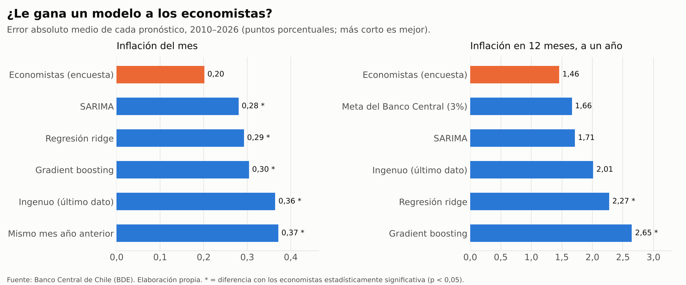
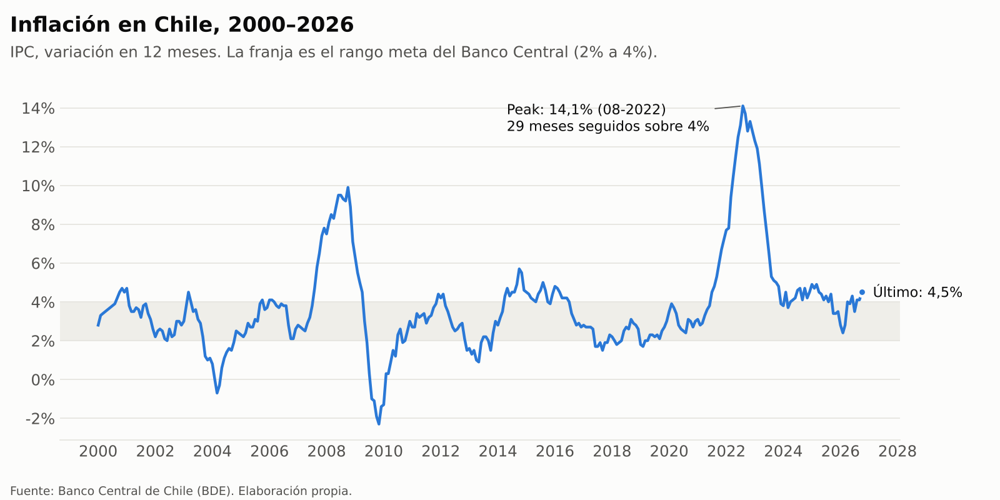
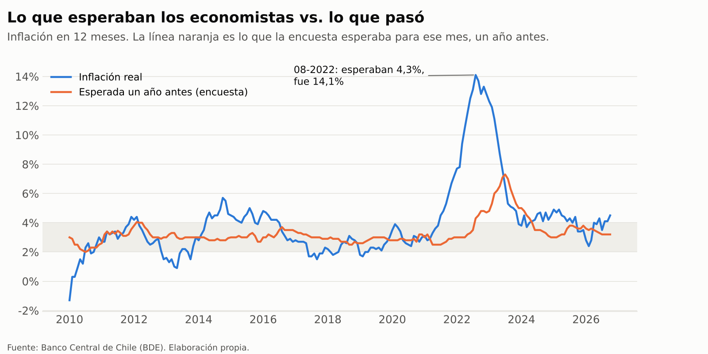

# ¿Le gana un modelo a los economistas pronosticando la inflación en Chile?

Todos los meses el Banco Central le pregunta a un grupo de economistas cuánta inflación esperan. Quise saber si un
modelo, con los mismos datos públicos y sin ver el futuro, podía pronosticar mejor que ellos. Así que armé una
competencia justa con 16 años de pronósticos reales (2010–2026).

**Respuesta corta:** en la inflación del mes, los economistas ganan claro. A un año plazo, no le ganan de forma
demostrable ni a decir "3%" todos los meses, y desde 2024 un SARIMA simple se equivoca menos que ellos.



| | Economistas | Mejor modelo | ¿Diferencia real? |
|---|---|---|---|
| Inflación del mes | **0,20 pp** de error promedio | SARIMA: 0,28 pp | Sí (p < 0,001): ganan los economistas |
| Inflación en 12 meses, a un año | **1,46 pp** | Meta del 3%: 1,66 pp · SARIMA: 1,71 pp | No (p ≈ 0,3) |
| A un año, solo desde 2024 | 0,87 pp | **SARIMA: 0,74 pp** | Pocos meses para afirmarlo |

El análisis completo, con gráficos y conclusiones, está en el
[notebook](notebooks/01_analisis.ipynb).

## Lo que encontré



- **El episodio 2021–2023 fue el más largo y alto de la serie:** 29 meses seguidos sobre el 4%, con un peak de 14,1%
  en agosto de 2022. Y no fue solo comida y energía: la inflación subyacente (sin esos dos) llegó a 10,8%.
- **Los economistas no lo vieron venir, y nadie lo vio.** En septiembre de 2021 esperaban 4,3% para agosto de 2022.
  Ningún modelo basado en el pasado lo anticipó tampoco.
- **Desde 2024 los economistas siguen subestimando la inflación**, en promedio medio punto, como si siguieran anclados a la meta.
- **El dólar sí pasa a los precios, pero menos de lo que pensaba.** En 2010–2019, cada 10% que sube el dólar viene con
  unos 0,75 puntos más de inflación, con unos dos meses de rezago (correlación 0,61). Mirando todo el período la
  relación se debilita, porque en los grandes shocks pesaron otras cosas.
- **Más complejo no es mejor.** Ridge y gradient boosting, con dólar, cobre, tasa e Imacec, quedaron peor que un
  SARIMA que solo mira la propia inflación. Con 250 meses de historia y un shock sin precedentes, no hay suficiente
  información para aprender relaciones complejas.



## Cómo hice la comparación justa

Lo más fácil en un proyecto así es hacer trampa sin darse cuenta: entrenar con datos que todavía no existían el día del
pronóstico. Para evitarlo:

- **Cada modelo ve solo lo que se sabía el día de la encuesta** (cerca del día 10 de cada mes): el IPC hasta el mes
  anterior, el dólar y la tasa del mes anterior y el Imacec de dos meses atrás, porque se publica con rezago
  (`dominio/disponibilidad.py`).
- **Los modelos se reentrenan cada mes** con los datos disponibles hasta ese momento. Así se habrían usado de verdad.
- **Hay tests que lo prueban:** cambian todos los datos desde el mes de la encuesta en adelante y verifican que el
  pronóstico no se mueve (`tests/test_competencia.py`).
- **La diferencia se prueba con estadística,** no a ojo: test de Diebold-Mariano con la corrección para muestras
  pequeñas y pronósticos que se traslapan.

Los competidores: tres referencias simples (repetir el último dato, el mismo mes del año anterior, la meta del 3%),
un SARIMA y dos modelos de machine learning (regresión ridge y gradient boosting).

## Cómo está hecho

- **Python 3.11+**, pandas, statsmodels y scikit-learn. Los datos salen de la API del Banco Central (BDE).
- **Clean Architecture**, igual que en mis otros proyectos: `dominio` (series, modelos, métricas; sin red ni
  archivos), `aplicacion` (casos de uso y puertos), `infraestructura` (cliente de la API, archivos CSV) y
  `presentacion` (línea de comandos y gráficos). Hay un test que falla si una capa importa a otra que no debe.
- **Se actualiza solo:** el 12 de cada mes, un workflow de GitHub Actions baja los datos nuevos, corre la competencia y
  regenera los gráficos. El token de la API vive como secreto del repo.
- **Calidad:** 25 tests (pytest), ruff y CI en cada push.

```
src/inflacion/
  dominio/          series, disponibilidad, modelos, metricas, analisis
  aplicacion/       puertos, catalogo, descarga, competencia
  infraestructura/  bcch (API del Banco Central), almacen_csv, config
  presentacion/     cli, graficos
config/series.toml  qué series se usan y cómo se transforman
data/               panel mensual y resultados (versionados)
notebooks/          análisis exploratorio y conclusiones
```

## Correrlo

```bash
pip install -e ".[modelos,dev]"
export BCCH_TOKEN=...          # se obtiene gratis en https://si3.bcentral.cl/Siete
python -m inflacion datos      # baja las series y arma data/panel_mensual.csv
python -m inflacion competir   # backtest: modelos vs economistas (~1 minuto)
python -m inflacion graficos   # regenera docs/img/
pytest
```

Sin token se puede correr todo menos `datos`: el panel ya está en el repo.

## Límites

Es un solo país, y el período incluye un shock enorme que pesa mucho en los promedios. La encuesta es una mediana, no
un pronóstico individual. Y los economistas tienen una ventaja que mis modelos no tienen: cuando responden ya conocen
parte de los precios del mes. Lo próximo que probaría es darles a los modelos los primeros días del mes (dólar diario,
combustibles) para emparejar la cancha.

## Fuente

Datos: Banco Central de Chile, Base de Datos Estadísticos (BDE). Los datos son propiedad del Banco Central de Chile;
el análisis, los modelos y sus errores son míos.

## English summary

Can a model beat professional economists at forecasting Chilean inflation? Using the Central Bank of Chile's API, I
built a leak-free backtest (2010–2026) where every model only sees the data available on the day economists answered
the Central Bank's monthly survey. Economists clearly win on next-month inflation. At a one-year horizon they don't
significantly beat a "3% target" rule or a simple SARIMA, and since 2024 the SARIMA has had lower errors. Python,
pandas, statsmodels and scikit-learn, clean architecture with a test that enforces layer boundaries, Diebold-Mariano
tests, and a GitHub Actions pipeline that refreshes data, results and charts every month.

## Autor

Matías Munizaga — Ingeniero en Informática (INACAP, 2025), Coquimbo, Chile.
